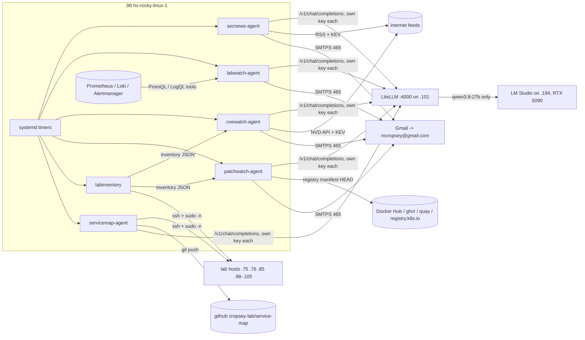

# mikes-agents

Small, scheduled AI agents for the Cropsey home lab. They all run on **192.168.1.98** (hv-rocky-linux-1)
as podman containers started by systemd timers. They reach the local LLM (**qwen3.8-27b** in LM Studio on an
RTX 5090) only through the **LiteLLM** gateway on .101, and they email their reports through Gmail.

| Agent | What it does | Schedule (America/Chicago) | Manual run on .98 |
|---|---|---|---|
| [secnews-agent](secnews-agent/) | Cybersecurity news briefing from 9 RSS feeds + CISA KEV | daily 06:00 | `secnews` |
| [labwatch-agent](labwatch-agent/) | Lab health briefing; investigates Prometheus/Loki with its own tool calls | daily 06:15 | `labwatch` |
| [cvewatch-agent](cvewatch-agent/) | Matches newly published CVEs against the software in the lab; emails only if affected | daily 06:30 | `cvewatch` |
| [patchwatch-agent](patchwatch-agent/) | Daily patch plan: OS updates, security advisories, reboots, container image drift | daily 06:45 | `patchwatch` |
| [labinventory](labinventory/) | Software inventory of every lab host over SSH (no LLM); feeds cvewatch + patchwatch | daily 05:30 | `labinventory` |
| [servicemap-agent](servicemap-agent/) | Maps every service, timer, cron job, container, k8s workload and AI agent on the hosts Grafana monitors; page on .98:9440 + Grafana, published to cropsey-lab | daily 05:40 | `servicemap` |
| [alertwatch-agent](alertwatch-agent/) | **Event-driven** triage of Alertmanager alerts (reuses labwatch's Prometheus/Loki tools); bounded to protect the GPU | on alert + daily 07:00 | `alertwatch` |
| [patchrun-agent](patchrun-agent/) | Applies the OS **security** updates patchwatch recommends, **approval-gated**, dry-run by default, never reboots | on demand | `patchrun` |
| [weekrollup-agent](weekrollup-agent/) | Weekly digest of every agent's reports **plus a quality check** that flags reports contradicting the data | Fri 06:55 | `weekrollup` |
| [agentdemo-agent](agentdemo-agent/) | Demo: a **safe agent vs a hijacked (prompt-injected) agent** driving the same crAPI MCP tools, for API-security talks | on demand | `agentdemo` |
| [llmredteam-agent](llmredteam-agent/) | Safety/guardrail **eval** of the LiteLLM gateway: OWASP-LLM-style probes, judged pass/fail | Sun 06:50 | `llmredteam` |

The last five were added **2026-10-19**: three practical (alertwatch, patchrun, weekrollup) and two for
API-security demos (agentdemo, llmredteam). See [TALKING-POINTS.md](TALKING-POINTS.md) for the demo narration.

Maintenance helper scripts (not agents) are in [ops](ops/), e.g. the one-at-a-time reboot run used after patching.
[agenthub](agenthub/) exports every agent's latest report to Prometheus + Loki for the Grafana dashboard
**Agent Lab · Daily Reports**.

Shared code for labwatch/cvewatch/patchwatch is in [lab-agents-common](lab-agents-common/) (one image,
`localhost/labagents`). secnews is standalone (image `localhost/secnews`). LiteLLM registration is in
[litellm](litellm/).

## Architecture



```
 05:30 labinventory ──ssh──► 11 lab hosts ──► /opt/labagents/data/inventory/latest.json
 05:40 servicemap   ──ssh──► Grafana's hosts ──► LLM labels ──► :9440 page + Grafana + GitHub
 06:00 secnews  ─┐
 06:15 labwatch ─┼─► LiteLLM (.101:4000) ──► LM Studio qwen3.8-27b (.194, RTX 5090)
 06:30 cvewatch ─┤        one virtual key + agent-registry entry per agent
 06:45 patchwatch┘       (agentdemo uses two keys; llmredteam uses two)
 06:50 llmredteam (Sun)  guardrail eval
 06:55 weekrollup (Fri)  weekly digest + agent quality check
 07:00 alertwatch        daily heartbeat (also fires on any Alertmanager alert, any time)
        └──► reports saved on .98 + emailed via smtp.gmail.com:465

 on demand:  patchrun (approval-gated patching) · agentdemo (safe vs hijacked agent)
 event:      Alertmanager alert ──webhook──► alertwatch receiver (:9435) ──► triage
```

The 2026-10-19 agents keep the GPU rules: the scheduled ones (llmredteam, weekrollup, alertwatch heartbeat) run
before 07:00; alertwatch is event-driven but **bounded** (coalesce + min-interval, and during 08:00-22:00 it
triages only `critical` alerts live, holding the rest for the top of the hour); agentdemo/patchrun are run by
hand. agentdemo and llmredteam each use **two** LiteLLM keys (two personas / probe+judge).

## Design rules

- **Local model only, one model only.** Every key is restricted to `qwen3.8-27b`. Calling other LM Studio
  models makes them load next to qwen3.8 and pushes it onto the CPU (~0.3 tok/s).
- **Run before the workday.** The GPU is used interactively 08:00-22:00, so all schedules finish before 07:00.
  A typical morning uses the GPU for ~8 minutes in total (secnews ~1.5 min, labwatch ~1.5 min, cvewatch ~1.5 min,
  patchwatch ~3.5 min).
- **One LiteLLM key and one agent-registry entry per agent**, so spend and traffic are attributed per agent
  on the LiteLLM *Agents* page. Keys allow 1 request in flight and 30 rpm.
- **Guardrail opt-out.** LiteLLM's `basic-safety-filter` content filter (on by default for all traffic) blocks
  normal security vocabulary ("attack", "exploit"...). The agent keys carry
  `metadata.opted_out_global_guardrails: ["basic-safety-filter"]`; the filter stays on for everything else.
- **No secrets in this repo.** Keys and the Gmail app password live only in root-only env files on .98
  (`/opt/secnews/secnews.env`, `/opt/labagents/labagents.env`). The `*.env.example` files are templates.

## Layout on .98

| Path | Contents |
|---|---|
| `/opt/secnews/` | `app/` (secnews.py, Containerfile), `secnews.env` (600), `data/reports/` |
| `/opt/labagents/` | `app/labagents/` (common + agent modules), `app/labinventory.py`, `app/Containerfile`, `hosts.conf`, `labagents.env` (600), `data/inventory/`, `data/reports/<agent>/` |
| `/usr/local/bin/` | `secnews`, `labwatch`, `cvewatch`, `patchwatch`, `labinventory`, `servicemap`, `alertwatch`, `patchrun`, `weekrollup`, `agentdemo`, `llmredteam` |
| `/etc/systemd/system/` | `<name>.service` + `<name>.timer` for the scheduled agents; plus `alertwatch.service` (always-on receiver) and `alertwatch-heartbeat.service` (the heartbeat the timer runs) |

Reports: `/opt/secnews/data/reports/latest.html` and `/opt/labagents/data/reports/<agent>/latest.html`.
Browse them all at **http://192.168.1.98:9440/reports/** (LAN only; served by `servicemap-web`, linked from Grafana and
from the footer of the cropseyit.com page on rasp5). In Grafana: *Agent Lab · Daily Reports* and *Lab Service Map*.

## Install everything from scratch

Prerequisites on .98: Rocky 9, rootful podman, `sudo`, passwordless SSH from `mcropsey` to every lab host
with `sudo -n` there (labinventory and servicemap need that). For servicemap's GitHub publishing: a clone of
`cropsey-lab` at `~/cropsey-lab` that can push (HTTPS token in `~/.git-credentials`). On .101: LiteLLM in the `litellm` podman container.
A Gmail app password (https://myaccount.google.com/apppasswords, needs 2-Step Verification).

1. **LiteLLM keys** (on .101): see [litellm/README.md](litellm/README.md). One key per agent.
2. **secnews**: see [secnews-agent/README.md](secnews-agent/README.md).
3. **Shared lab-agents image + env**: see [lab-agents-common/README.md](lab-agents-common/README.md).
4. **labinventory**, then **labwatch**, **cvewatch**, **patchwatch**: see each folder's README.
5. **servicemap-agent** (map page on :9440, reports listing, Grafana dashboard, Prometheus job, GitHub publishing):
   see [servicemap-agent/README.md](servicemap-agent/README.md).
6. **agenthub** (reports into Prometheus + Loki, *Agent Lab · Daily Reports* dashboard): see [agenthub/README.md](agenthub/README.md).

Quick version, run from a checkout of this repo on .98:

```bash
# shared image
sudo mkdir -p /opt/labagents/app/labagents /opt/labagents/data && sudo chown mcropsey: /opt/labagents/data
sudo cp lab-agents-common/labagents/*.py labwatch-agent/labwatch.py cvewatch-agent/cvewatch.py \
        patchwatch-agent/patchwatch.py servicemap-agent/servicemap.py /opt/labagents/app/labagents/
sudo cp lab-agents-common/Containerfile /opt/labagents/app/
sudo install -m 600 lab-agents-common/labagents.env.example /opt/labagents/labagents.env   # fill in keys + SMTP_PASS
sudo podman build -t localhost/labagents:latest -f /opt/labagents/app/Containerfile /opt/labagents/app

# inventory collector (runs on the host as mcropsey)
sudo install -m 755 labinventory/labinventory.py /opt/labagents/app/labinventory.py
sudo install -m 644 labinventory/hosts.conf /opt/labagents/hosts.conf

# wrappers + timers
for a in labinventory/labinventory labwatch-agent/labwatch cvewatch-agent/cvewatch patchwatch-agent/patchwatch; do
  sudo install -m 755 $a /usr/local/bin/; done
sudo cp labinventory/*.service labinventory/*.timer labwatch-agent/*.service labwatch-agent/*.timer \
        cvewatch-agent/*.service cvewatch-agent/*.timer patchwatch-agent/*.service patchwatch-agent/*.timer \
        /etc/systemd/system/
sudo systemctl daemon-reload
sudo systemctl enable --now labinventory.timer labwatch.timer cvewatch.timer patchwatch.timer

labinventory && labwatch --no-email && cvewatch --no-email && patchwatch --no-email   # smoke test

# servicemap: collector, publisher, web server (:9440), wrapper, units
sudo install -m 755 servicemap-agent/servicemap_collect.py servicemap-agent/servicemap_publish.sh \
        servicemap-agent/servicemap_web.py /opt/labagents/app/
sudo install -m 755 servicemap-agent/servicemap /usr/local/bin/
sudo cp servicemap-agent/servicemap.service servicemap-agent/servicemap.timer servicemap-agent/servicemap-web.service \
        /etc/systemd/system/
# open :9440 WITHOUT firewall-cmd --reload (a reload on .98/.101/.102 can break container networking)
sudo firewall-cmd --add-port=9440/tcp && sudo firewall-cmd --permanent --add-port=9440/tcp

# agenthub: report exporter on :9430
sudo mkdir -p /opt/agenthub && sudo install -m 755 agenthub/agenthub.py /opt/agenthub/
sudo cp agenthub/agenthub.service /etc/systemd/system/

sudo systemctl daemon-reload
sudo systemctl enable --now servicemap-web.service agenthub.service servicemap.timer
servicemap                                                                             # first map + publish

# agents added 2026-10-19 (alertwatch, patchrun, weekrollup, agentdemo, llmredteam)
sudo cp lab-agents-common/labagents/{mcpclient,alertwatch,weekrollup,patchrun,agentdemo,llmredteam}.py \
        /opt/labagents/app/labagents/                                                  # + rebuild image (podman build line above)
sudo mkdir -p /opt/labagents/data/reports/{alertwatch,weekrollup,patchrun,agentdemo,llmredteam}
for a in alertwatch-agent/alertwatch weekrollup-agent/weekrollup patchrun-agent/patchrun \
         agentdemo-agent/agentdemo llmredteam-agent/llmredteam; do sudo install -m 755 $a /usr/local/bin/; done
sudo cp alertwatch-agent/*.service alertwatch-agent/*.timer weekrollup-agent/*.service weekrollup-agent/*.timer \
        llmredteam-agent/*.service llmredteam-agent/*.timer /etc/systemd/system/
sudo systemctl daemon-reload
sudo systemctl enable --now alertwatch.service alertwatch.timer weekrollup.timer llmredteam.timer
# Alertmanager -> alertwatch: set the webhook receiver in /opt/monitoring/alertmanager/config/alertmanager.yml
#   (route.receiver: alertwatch, webhook url http://192.168.1.98:9435/alert) and restart alertmanager.
# LiteLLM keys for all seven new aliases: see litellm/README.md. Grafana dashboard: agenthub/grafana/agents-ii.json.

# Grafana + Prometheus on .98 (see servicemap-agent/README.md and agenthub/README.md):
#   dashboards -> /opt/monitoring/grafana/dashboards/{Lab Service Map,Agent Lab}/
#   Prometheus jobs `agenthub` (localhost:9430) and `servicemap` (localhost:9440) in prometheus/config/prometheus.yml
```

Not in this repo, kept with the monitoring stack on .98: the Prometheus config and the rest of the Grafana dashboards
(`/opt/monitoring`, generator `gen_dashboards.py`; see `cropsey-lab/lab-inventory.md`).

## Operating

```bash
systemctl list-timers 'secnews*' 'lab*' 'cvewatch*' 'patchwatch*'   # next runs
journalctl -u labwatch --since today                                 # logs of a scheduled run
labwatch --help                                                      # every agent takes --no-email / --to
```

To change code: edit the file under `/opt/labagents/app/labagents/` (or `/opt/secnews/app/`), then rebuild
that image with the `podman build` line above. Env-file edits apply on the next run without a rebuild.

## Troubleshooting (all agents)

| Symptom | Cause / fix |
|---|---|
| `Content blocked: harmful_violence ... 'attack'` (HTTP 400) | Key isn't opted out of `basic-safety-filter`; add `opted_out_global_guardrails` to the key metadata (see litellm/). |
| `model gave no JSON answer` / `finish_reason=length` | qwen3.8's reasoning used up `max_tokens` (24000). Shrink the prompt or raise the limit in `common.py`. |
| Very slow LLM calls | Another model is loaded in LM Studio next to qwen3.8; unload it. |
| Email `535` auth error | Gmail app password revoked or Google password changed; make a new app password, update both env files. |
| `401`/`403` from LiteLLM | Key deleted or its model list changed; re-run `litellm/register_agent.py` for that agent. |
| No email at all | `journalctl -u <agent> --since today`. A failed run sends nothing; cvewatch also stays quiet when nothing affects the lab. |
| alertwatch never triages a daytime alert | By design: 08:00-22:00 it triages only `critical` alerts live and holds the rest to the top of the hour. Check the receiver got it: `journalctl -u alertwatch`. |
| alertwatch didn't get the alert | Alertmanager receiver must be `alertwatch` with webhook `http://192.168.1.98:9435/alert`; restart alertmanager after editing (no lifecycle reload on v0.34.1). |
| agentdemo: `connect`/MCP error | The crapi-mcp server on `.102:8009` must be up and `AGENTDEMO_MCP_URL` correct; test with `curl -X POST .../mcp` initialize. |
| patchrun: "approval token does not match" | A newer patchwatch report changed the plan id. Run a dry-run (`patchrun`) to get the current token. |
| llmredteam shows everything `blocked` | Expected if the probe key is opted out of the guardrail — it must **not** be. Check `LLMREDTEAM_PROBE_KEY`'s metadata in LiteLLM. |
